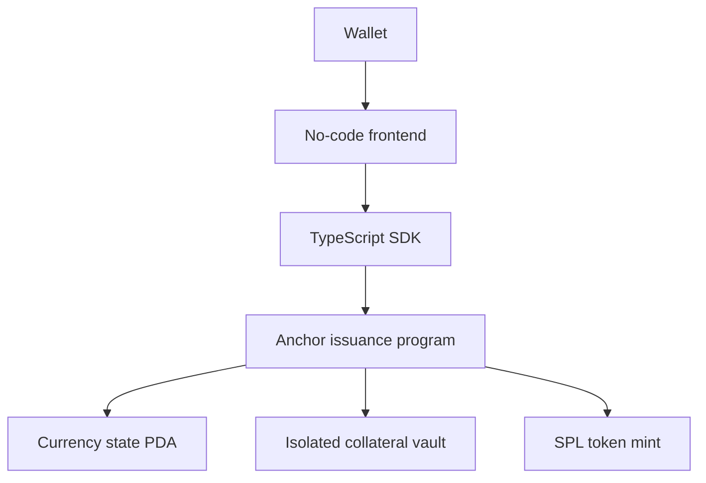

# Proposed architecture

## MVP
Use a configured USDC mint, standard SPL Token and six-decimal currencies. Each currency binds its mint, collateral mint and vault to program-controlled PDAs. No external mint authority.

- Create: initialize state, mint and independent vault.
- Mint: deposit collateral and mint equal base units atomically.
- Redeem: burn holder tokens and release equal collateral atomically.
- Convert: burn source tokens, transfer collateral between validated vaults and mint destination tokens atomically. Require compatible collateral and redemption terms.
- Distribute: standard SPL transfers.

## Security
Reserve balance must cover outstanding supply. Validate signers, mint addresses, PDA seeds, token program and account relationships. Reject zero amounts, arithmetic errors and unauthorized withdrawals. Test rollback, cross-vault substitution and reserve isolation. Direct burns and donations can create excess reserves. Upgrade authority and collateral issuer remain trust assumptions. No real funds before audit.

## Interface
Next.js, TypeScript, wallet signing and RPC-based reserve dashboard. SDK builds transactions without custody of keys.

## Future
SOL-backed issuance requires oracle validation, overcollateralization, liquidation and bad-debt rules. Ordinary token creation remains separate from backed assets.
