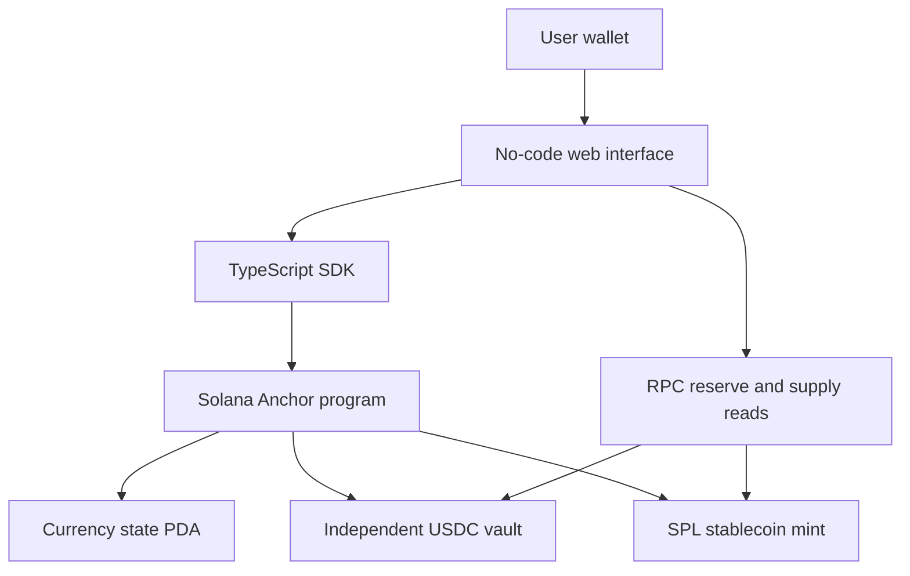

# Solo-X

### The infrastructure for programmable stablecoins.

Permissionless, no-code stablecoin issuance and settlement infrastructure on Solana.

Built by **Team YinYang**.

## Overview

Solo-X is a proposed wallet-first issuance and settlement protocol for custom collateral-backed currencies on Solana. It combines a no-code workspace with reusable on-chain instructions and a TypeScript SDK, allowing issuers and integrators to use a common reserve and redemption model.

**Development status:** Pre-MVP. The protocol and interface described here are design targets, not production services.

## Problem statement

Launching a redeemable stablecoin requires blockchain engineering, secure collateral management, mint and redemption logic, and settlement infrastructure. These barriers make custom currencies difficult for individuals, communities, businesses and institutions to operate. Multiple custom currencies can also fragment liquidity.

## Our solution

Solo-X aims to provide a wallet-first platform where anyone can create, issue, distribute, manage, exchange and redeem collateral-backed stablecoins without writing code. Reusable on-chain programs enforce reserve and redemption rules.

## Core design pillars

- No-code stablecoin creation.
- Permissionless wallet-first access.
- USDC-backed issuance, with SOL-backed issuance planned.
- Independent on-chain collateral vaults per currency.
- Automated smart-contract-enforced redemption.
- Atomic interoperability between compatible USDC-backed currencies.
- Accessibility to individuals, communities, businesses and institutions.

Ordinary token creation is a complementary feature, separate from collateral-backed currencies.

## How it works

1. Connect a wallet and configure a currency.
2. Initialize its mint and independent collateral vault.
3. Deposit USDC to mint matching units.
4. Distribute or transfer the issued currency.
5. Convert compatible currencies atomically or burn tokens to redeem collateral.

## Protocol lifecycle

| Operation | Proposed behavior |
|---|---|
| Create | Initialize currency state, SPL mint and isolated collateral vault. |
| Mint | Deposit configured USDC and issue equal base units atomically. |
| Transfer | Distribute issued tokens through standard SPL transfers. |
| Convert | Burn source tokens, move collateral between compatible vaults and mint destination tokens in one transaction. |
| Redeem | Burn issued tokens and release matching collateral. |
| Inspect | Read mint supply and vault balances through Solana RPC. |

For example, depositing 100 test USDC would issue 100 units of a six-decimal custom currency. Redeeming 25 units would burn those units and return 25 test USDC. This illustrates the intended accounting model, not a live transaction.

## Product experience

The proposed interface uses a white canvas, Outfit typography and a purple (#9945FF) to green (#14F195) gradient. The landing page leads to an Enter Workspace action; the workspace uses feature cards rather than a permanent sidebar. Planned flows cover currency creation, reserve management, minting, transfers, conversion and redemption. Wallet signatures authorize transactions; the frontend does not hold private keys.

## Architecture



The proposed MVP uses six-decimal SPL tokens and program-controlled mint and vault authorities. Minting and redemption exchange equal base units of collateral and issued tokens. Conversion moves collateral between validated vaults atomically. See [architecture](ARCHITECTURE.md) for constraints and security assumptions.

## Security model and limitations

- Reserve balance must cover outstanding supply; direct burns or donations may produce excess reserves.
- Program-derived authorities control minting and vault withdrawals.
- Validate account ownership, PDA seeds, mint relationships, token program and signers.
- Reject zero amounts, arithmetic errors and incompatible conversion routes.
- Test reserve isolation, transaction rollback and cross-vault substitution.
- USDC issuer risk and program upgrade authority remain trust assumptions.
- SOL-backed issuance is outside the initial MVP and requires oracle, liquidation and bad-debt mechanisms.

## Ecosystem impact

Solo-X aims to expand access to Solana financial infrastructure, generate recurring on-chain activity, improve reserve transparency, and give developers reusable issuance and settlement tools. SOL collateral utility is a future objective, not a deployed capability.

## Use cases

| Audience | Potential application |
|---|---|
| Communities and campuses | Redeemable local payment units |
| Businesses | Branded settlement and payment assets |
| Gaming platforms | Collateral-backed in-game economies |
| Fintech developers | SDK-based issuance and redemption integrations |

## MVP acceptance targets

- Create two independent USDC-backed test currencies.
- Mint, transfer, convert and redeem using wallet-authorized transactions.
- Verify supply and reserve accounting before and after operations.
- Reject unauthorized or invalid transactions without partial state changes.
- Demonstrate the full lifecycle on devnet using clearly labeled test collateral.

## Getting started

The repository is in its foundation phase. Clone it to review the architecture and contribution guidelines:

```bash
git clone https://github.com/Team-YinYang/Solo-X.git
cd Solo-X
```

The Anchor workspace is ready for local development. Follow the [local setup guide](docs/SETUP.md) to install the pinned toolchain, start a validator and run the smoke test.

The Next.js/SDK workspaces are scaffolded in `apps/web` and `packages/sdk`. With Node 22 and npm 10, run `npm ci`, `npm run dev`, `npm run lint`, `npm run typecheck`, `npm run build`, and `npm run test`. See [web and SDK setup](docs/WEB_SDK.md) and [wallet connection](docs/WALLET.md). The wallet panel is limited to proof-of-ownership on devnet or localnet; protocol transactions are not yet implemented. See [ROADMAP.md](ROADMAP.md) for milestones.

## Proposed technology stack

| Layer | Technology |
|---|---|
| Blockchain | Solana |
| On-chain program | Rust, Anchor, SPL Token |
| Interface | Next.js, TypeScript, Tailwind CSS |
| Wallet | Solana Wallet Adapter |
| SDK | TypeScript |
| Testing | Anchor, local validator |
| CI | GitHub Actions |
| Initial deployment | Devnet |

## Development backlog

| Workstream | Issues |
|---|---|
| Foundation and CI | [#1](../../issues/1), [#2](../../issues/2), [#3](../../issues/3) |
| Core protocol | [#4](../../issues/4), [#5](../../issues/5), [#6](../../issues/6), [#7](../../issues/7), [#8](../../issues/8) |
| SDK | [#9](../../issues/9) |
| Frontend | [#10](../../issues/10), [#11](../../issues/11), [#12](../../issues/12), [#13](../../issues/13), [#14](../../issues/14) |
| Security and demo | [#15](../../issues/15), [#16](../../issues/16) |
| Stretch features | [#17](../../issues/17), [#18](../../issues/18) |
| Post-MVP | [#19](../../issues/19), [#20](../../issues/20) |

[View all issues](https://github.com/Team-YinYang/Solo-X/issues)

## Documentation and contributions

- [Architecture](ARCHITECTURE.md)
- [Roadmap](ROADMAP.md)
- [Contribution guidelines](CONTRIBUTING.md)
- [Local setup](docs/SETUP.md)
- [Currency initialization](docs/CURRENCY_INITIALIZATION.md)
- [Collateral-backed minting](docs/MINTING.md)
- [Wallet connection](docs/WALLET.md)

Claim an issue, work on a feature branch and submit a reviewed pull request with tests. Setup commands will be added after scaffolding.

## Status and security

Early development. Features above are planned, not deployed. No audited program exists yet. Use local validator or devnet with clearly labelled test collateral only. Do not deposit real funds. SOL-backed issuance requires a separate oracle, liquidation and bad-debt design. License selection is pending team approval.
