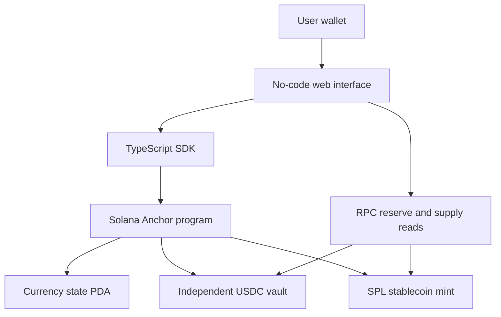

# Solo-X

### Create stablecoins, not code.

Permissionless, no-code stablecoin issuance and settlement infrastructure on Solana.

Built by **Team YinYang**.

## Problem statement

Launching a redeemable stablecoin requires blockchain engineering, secure collateral management, mint and redemption logic, and settlement infrastructure. These barriers make custom currencies difficult for individuals, communities, businesses and institutions to operate. Multiple custom currencies can also fragment liquidity.

## Our solution

Solo-X aims to provide a wallet-first platform where anyone can create, issue, distribute, manage, exchange and redeem collateral-backed stablecoins without writing code. Reusable on-chain programs enforce reserve and redemption rules.

## Core design pillars

- No-code stablecoin creation.
- Permissionless wallet-first access.
- USDC-backed issuance, with SOL-backed issuance planned.
- Independent on-chain collateral vaults per currency.
- Automated smart-contract-enforced redemption.
- Atomic interoperability between compatible USDC-backed currencies.
- Accessibility to individuals, communities, businesses and institutions.

Ordinary token creation is a complementary feature, separate from collateral-backed currencies.

## How it works

1. Connect a wallet and configure a currency.
2. Initialize its mint and independent collateral vault.
3. Deposit USDC to mint matching units.
4. Distribute or transfer the issued currency.
5. Convert compatible currencies atomically or burn tokens to redeem collateral.

## Architecture

The proposed MVP uses six-decimal SPL tokens and program-controlled mint and vault authorities. Minting and redemption exchange equal base units of collateral and issued tokens. Conversion moves collateral between validated vaults atomically. See [architecture](ARCHITECTURE.md) for constraints and security assumptions.

## Ecosystem impact

Solo-X aims to expand access to Solana financial infrastructure, generate recurring on-chain activity, improve reserve transparency, and give developers reusable issuance and settlement tools. SOL collateral utility is a future objective, not a deployed capability.

## Use cases

Community currencies, campus payment systems, branded business settlement assets, gaming economies and fintech integrations.

## Proposed technology stack

| Layer | Technology |
|---|---|
| Blockchain | Solana |
| On-chain program | Rust, Anchor, SPL Token |
| Interface | Next.js, TypeScript, Tailwind CSS |
| Wallet | Solana Wallet Adapter |
| SDK | TypeScript |
| Testing | Anchor, local validator |
| CI | GitHub Actions |
| Initial deployment | Devnet |

## Development backlog

| Workstream | Issues |
|---|---|
| Foundation and CI | [#1](../../issues/1), [#2](../../issues/2), [#3](../../issues/3) |
| Core protocol | [#4](../../issues/4), [#5](../../issues/5), [#6](../../issues/6), [#7](../../issues/7), [#8](../../issues/8) |
| SDK | [#9](../../issues/9) |
| Frontend | [#10](../../issues/10), [#11](../../issues/11), [#12](../../issues/12), [#13](../../issues/13), [#14](../../issues/14) |
| Security and demo | [#15](../../issues/15), [#16](../../issues/16) |
| Stretch features | [#17](../../issues/17), [#18](../../issues/18) |
| Post-MVP | [#19](../../issues/19), [#20](../../issues/20) |

[View all issues](https://github.com/Team-YinYang/Solo-X/issues)

## Documentation and contributions

- [Architecture](ARCHITECTURE.md)
- [Roadmap](ROADMAP.md)
- [Contribution guidelines](CONTRIBUTING.md)

Claim an issue, work on a feature branch and submit a reviewed pull request with tests. Setup commands will be added after scaffolding.

## Status and security

Early development. Features above are planned, not deployed. No audited program exists yet. Use local validator or devnet with clearly labelled test collateral only. Do not deposit real funds. SOL-backed issuance requires a separate oracle, liquidation and bad-debt design. License selection is pending team approval.
